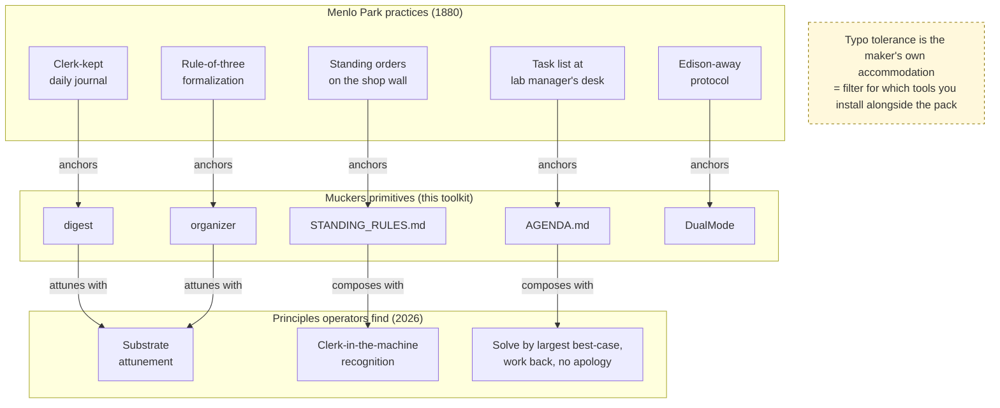

# Muckers architecture — how the pieces compose

Companion to [HISTORY.md](HISTORY.md) (origin) and [PRINCIPLES.md](PRINCIPLES.md) (what operators find). This file shows the composition visually — where each Menlo Park practice from 1880 anchors a muckers primitive, and where each primitive attunes with a principle operators keep finding.

---

## Three layers of the same shape

Bottom layer: the historical practices Edison and his fourteen muckers ran at Menlo Park in 1880 — where Batchelor, Kruesi, Upton and the rest kept the invention factory running.

Middle layer: the five primitives this toolkit ships. Each anchored to one specific practice from the layer below. Not because Edison "solved" the many-agent lab and I'm reusing his answer — the shape kept matching.

Top layer: three of the four principles operators find on the *other* side of installing the toolkit. The composition arrows show which primitive attunes with which principle. The fourth principle — typo tolerance — is not a primitive but a filter for choosing which tools you install alongside the pack. It sits outside the composition graph because it operates on what you bring in, not on what ships with the pack.

---

## Reading the composition arrows

- **`digest` + `organizer` → substrate attunement.** Both are substrate-capture primitives. Both work better once the operator has noticed the substrate can be attuned rather than just written-to.
- **`STANDING_RULES.md` → clerk-in-the-machine recognition.** Standing rules are what keep the clerk-role clean turn to turn. Without them the clerk drifts and the operator burns turns re-correcting.
- **`AGENDA.md` → solve-by-largest-best-case.** Largest goal at the top, working-backward steps underneath. Cadence discipline keeps the operator in flow while working toward it.
- **`DualMode`** doesn't have a mapped principle in this diagram — not because it lacks one but because operators haven't named the principle-shape of DualMode yet. Candidate for the next one to surface.

---

## Reading the anchor arrows

Each muckers primitive is a modern re-implementation of a 1880 Menlo Park practice. The anchor is real, not decorative — reading HISTORY.md's explanation of Charles Batchelor's role at the bench, or the 1880 office-staff journal that lived at Rutgers before it became `digest`, is how the practice earned its place in the modern pack.

Full mapping in [HISTORY.md § How each toolkit primitive maps to a Menlo Park practice](HISTORY.md#how-each-toolkit-primitive-maps-to-a-menlo-park-practice).

---

## What's not in the diagram

The operator. The operator is above the top layer, running the substrate. The whole diagram is a description of what sits between the operator and their many-agent stack. Every arrow is bidirectional in practice — principles inform how primitives get used, primitives shape what the operator notices, the noticing produces new principles. This diagram flattens time into structure; the real motion is recursive.
